나는 교대생. 3학년 실습이 돌아왔다. 2026년 10월 19일부터 30일까지, 금부초등학교에서 2주 동안 교육실습을 했다. 광주교대에서 25명이 같이 갔고 나는 3학년으로 실습을 가게됐다.

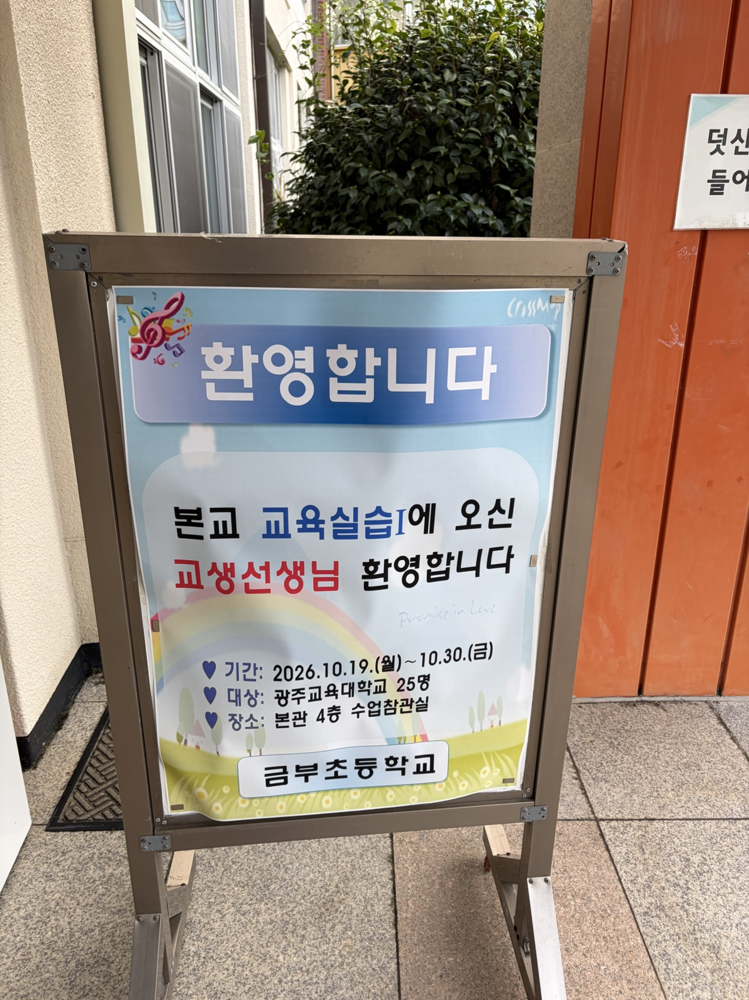

실습 기간은 2026.10.19~10.30, 광주교대 25명이 금부초등학교로 갔다.

아무래도 초등학교 교실로 직접 실습을 하는 AI Engineer는 이세상에 없을것이다.(아무래도..) 그래서 이번실습에서는 FDE의 시선에서 교내에서 어떤 페인포인트가 있는지, 그리고 그것을 해결하려면 어떻게 해야할지 파악하려고 했다.

## 회사에서는 노션이면 끝났다

회사에서는 기록도 보고문서도 노션으로 썼다. 노션 MCP를 연동하고 나면 완전 자동화가 가능했다. 내 업무 범위에서는 "문서 자동화"라는 말이 과장이 아니었다.

그래서 실습에서도 같은 방식을 그대로 가져가려고 했다. 보고서는 HOP(한글 수정 오픈소스 프로그램)을 에이전트에 연결하면 쉽게 되겠다고 봤다. 그런데 실제로 발목을 잡은 건 내용이 아니라 양식이었다. 글꼴, 글자 포인트, 자간. 공문으로 내보내려면 이 세 가지가 맞아야하는데, 그거 고치다가 시간이 다 갔다.

정해진 자간, 글자포인트, 글꼴이 정해져있었다. 그런데, 내가 사용하는 우분투 환경에서는 한글을 사용할 수 없었고, HOP 오픈소스로 한글파일을 수정하기에는 내부에 없는 글꼴, 그리고 자간이나 글자 크기등이 미묘하게 깨져서 다른 컴퓨터의 한글에서는 열리지않는다거나 이상하게 파일이 깨져보이는 문제들이 발생했다.

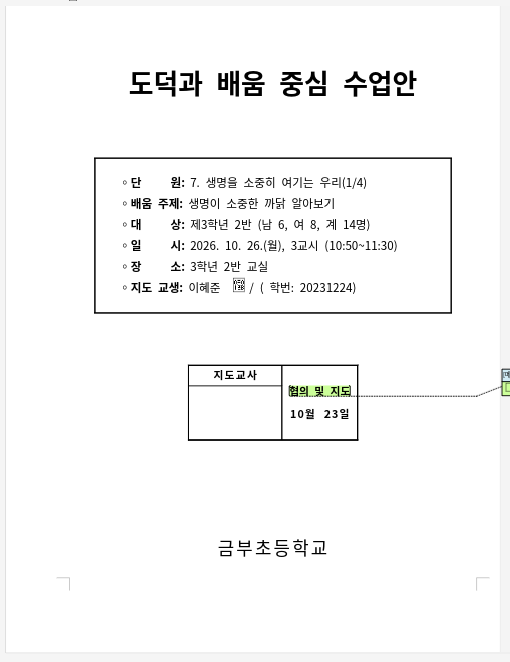

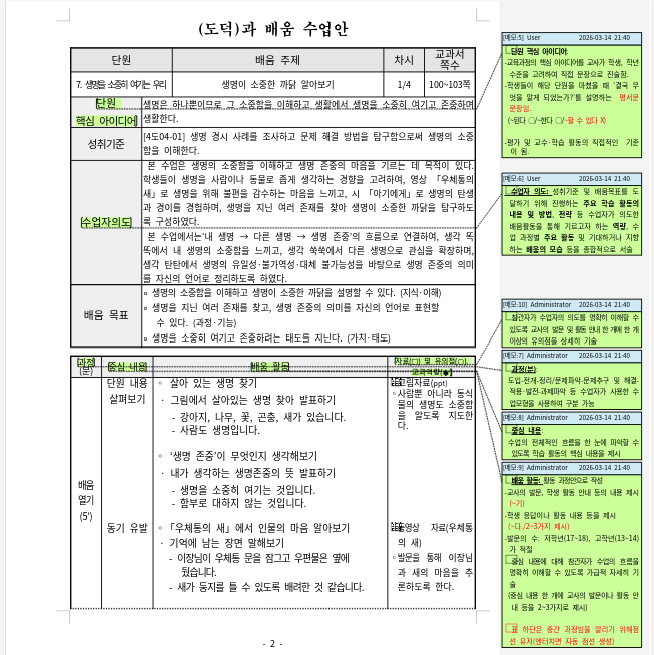

## 교실의 태블릿은 사진첩

교실마다 태블릿이 학생 수만큼 있었다. 1인 1태블릿이다. 수업에서는 Padlet 같은 공유 플랫폼을 쓰거나 HiClass를 쓴다. HiClass는 NiCE랑 연동해서 주로 쓴다고 했다. 용도는 대부분 같았다. 수업 시간에 한 활동을 사진으로 찍어서 학부모한테 공유하는 것.

그 이상으로 쓰이는 건 못 봤다. 에듀테크라고 부르는 것들이 교실에서는 사진이랑 댓글 주고받는 플랫폼으로 쓰이고 있었고, 그 모습은 2000년대 학급 홈페이지나 싸이월드에서 크게 다르지 않았다. 교실에서 사용하는 혹은 흔히 에듀테크, AI 세미나등을 참가해보면 개발자나 에듀테크 사업자는 교실에 어떤 기술이 필요한지 잘 모르는 것 같았고, 교사들도 뭐가 도움이 될지 잘 모르는 것 같았다. 2주 동안 나도 계속 생각해봤는데 확신이 선 답은 못 얻었다.

- 학생의 학습효과를 극대화하는 툴
- 교사의 인적 리소스를 최소화 하는 툴 → 추후 교사의 업무 완전 자동화까지

두가지로 에듀테크가 나뉠것 같은데 이를 가장 적극적으로 하는 기업은 얼마전 상장한 엘리스라고 생각한다. 근데 엘리스마저도, 이것저것 교실의 AX를 돕는다고 표방하고는 있지만, 실제로 위의 두가지 문제를 풀어내고 있는지는 의문이 든다.

1. 학생의 학습효과를 에듀테크로 극대화할 수 있는가?

    1. 이에 대해 답하기 위해서는 학생의 학습효과가 무엇인지부터 정의 해야한다. 그런데, 구체적 조작기에 있는 학생들에게는 앱 내에서 서비스 샌드박스안에서 체험하는게 아니라 실제 도구를 조작하는것이 유의미한 발달을 이끌어낸다고 한다. 따라서 학생의 학습효과를 에듀테크로 극대화할 수 있는 툴은 피지컬 컴퓨팅의 형태여야 하고, 단순 Agent내지 서비스로는 해결할 수 없다고 생각한다.

2. 교사의 인적 리소스를 최소화하는 툴

    1. 내가 수업안을 자동화하려고 했던 Agent를 예시로 들 수 있겠다. 하지만 회사에서 AX를 할때도 늘 받았던 피드백이지만, 이게 진짜로 임팩트가 있는지를 고려하고 기획해야한다. 교사의 인적 리소스를 0으로 만든다고 한들 이게 진짜 임팩트가 있는가? 교육부에 B2G로 팔 수 있는가? 교사의 인적리소스를 0으로 만드는것은 경제적인 임팩트가 없을 뿐더러 교사도(자기 직업이 없어진다고 생각할테니), 교육부(현상유지를 원하고, 교사의 업무를 줄이는건 교육부가 관심있는바가 아닐테니)도 원하는 바가 아닐테다.

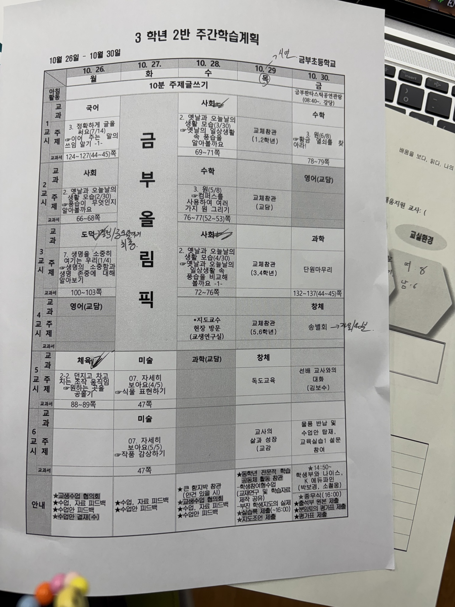

3학년 2반 주간학습계획. 한 주에 국어·사회·수학·과학·도덕·체육·미술·창체가 다 들어가고, 교체참관과 협의회, 각종 제출 일정이 같이 붙는다.

저학년은 에듀테크를 지양한다는 이야기도 협의회에서 나왔다. 발달단계상 구체적조작기인 학생한테는 직접 조작하는 활동이 유의미하다는 거다. 1학년 교체참관을 갔을 때 수업안과 수업을 보고 알 수 있었다. 시각 배우는 차시였는데 모형 시계를 손으로 돌려보면서 배웠다.

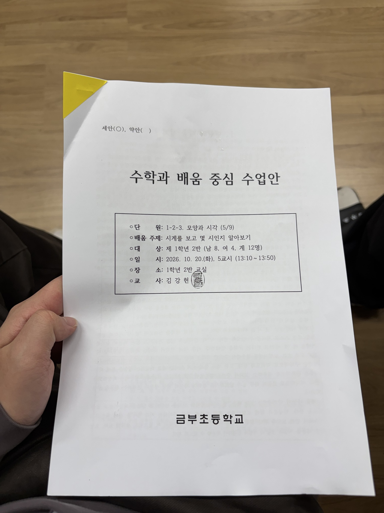

1학년 2반 「모양과 시각」 5/9차시 수업안.

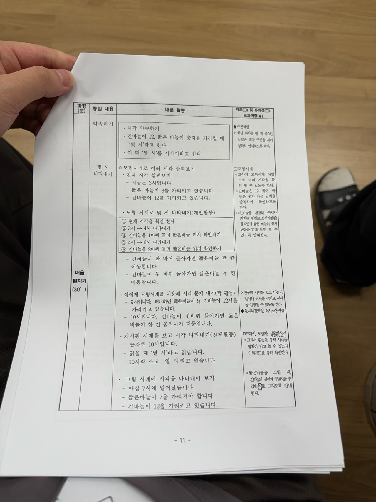

모형시계로 '몇 시'를 나타내는 차시. 긴바늘이 12를 가리킬 때 '몇 시'라고 하고, 긴바늘이 한 바퀴 돌면 짧은바늘이 한 칸 움직인다는 걸 손으로 확인한다.

## 수업안은 한글, 발표자료는 HTML

수업 하나 하려면 준비물이 여러 개다. 과목이랑 차시에 맞춰서 수업안을 한글로 쓰고, 활동지를 만들고, 발표자료를 만든다. 발표자료는 정해진 형식이 없어서 대부분 PPT나 미리캔버스, 캔바를 쓴다.

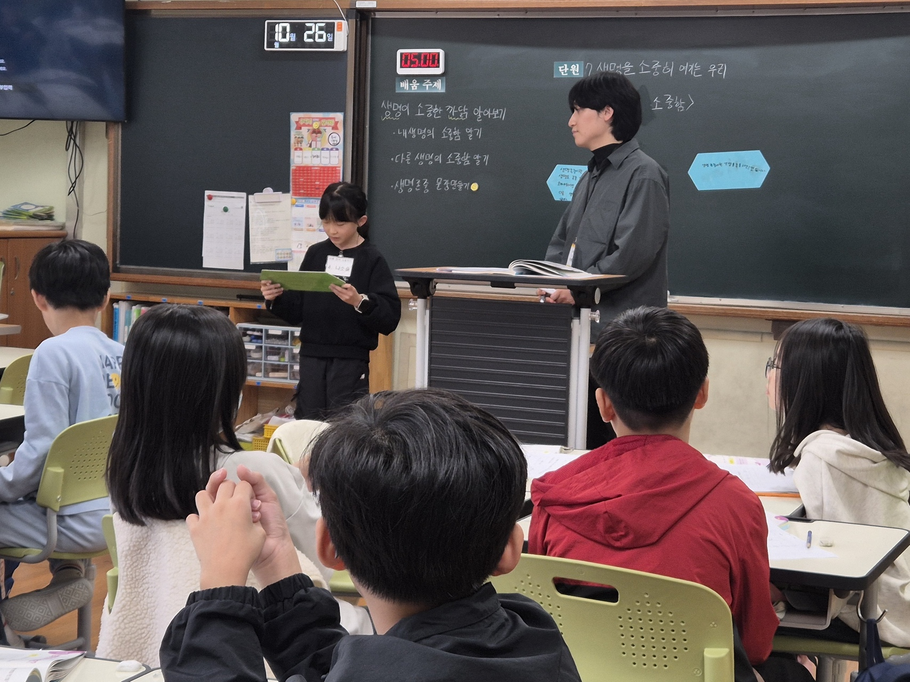

칠판에 단원과 배움 주제를 적고 학생 발표를 진행한 수업 장면.

나는 이번에 HTML로 만들었다. 수업안이랑 내 의도, 해당 차시 배움 내용을 에이전트에 컨텍스트로 넣고 덱을 짰다. 19장짜리 생명 단원 덱이다. 블로그 etc 페이지에 임베드해뒀으니까 화면에서 바로 넘겨볼 수 있다.

[발표덱 바로 보기](https://hyejunl33.github.io/etc/2026-10-23-life-lesson/)

3학년 2반 「생명을 소중히 여기는 우리」 1차시 발표덱 표지.

PPT보다 좋았던 건 인터랙티브하게 만들 수 있다는 점이다. 카드 끌어다 놓는 활동을 슬라이드 안에 넣을 수 있으니까, 넘기기만 하는 자료가 아니라 학생이 직접 만지는 자료가 된다.

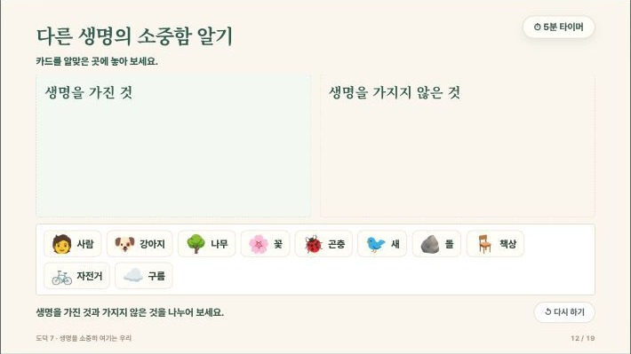

카드를 '생명을 가진 것'과 '가지지 않은 것'으로 나눠 놓는 활동 슬라이드. 슬라이드 위에서 바로 드래그할 수 있다.

여기서 한 번 더 막혔다. HOP를 Antigravity에 스킬 형태로 붙여봤는데, 이게 스킬이라고 부르는 게 맞는지는 잘 모르겠다. 어쨌든 한글 문서는 잘 못 고쳤다. 노션 MCP로 노션 페이지 고치는 건 쉬운데, 한글은 손봐야 할 게 너무 많다. 글꼴, 글씨 크기, 자간, 줄 간격이 다 어긋난다.

## 수업만 하는 게 아니다

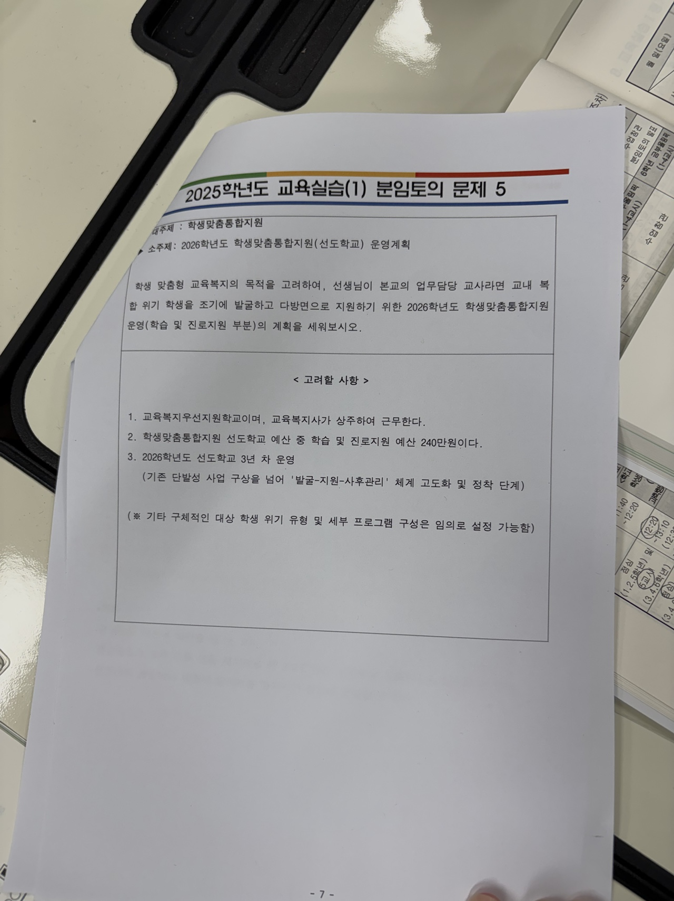

분임토의 문제 5. 학생맞춤통합지원 선도학교 운영계획을 세우는 과제였다.

교사는 수업만 안 한다. 학교폭력, 다문화 통합 지원, 기초학생 지원, 현장체험학습 기획 같은 교내 업무가 같이 붙는다. 담임이면 교육청에서 지원하는 사업이랑 공문을 훑어서 내 업무에 쓸 수 있는 예산이나 프로그램을 파악해야 하고, 교내 복지사나 행정직원이랑 협업해서 프로그램을 기획하고 예산을 배정받아서 집행한다.

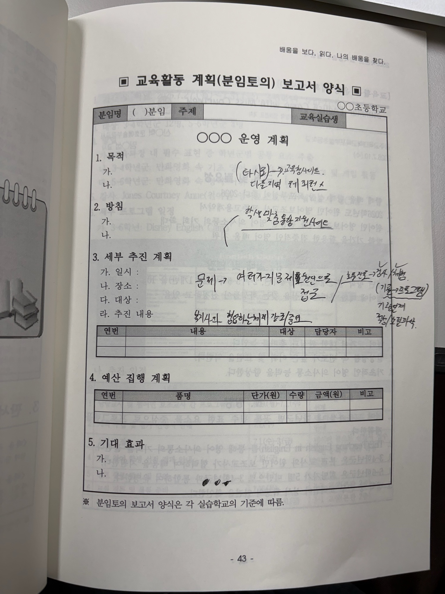

분임토의 보고서 양식. 항목은 이미 정해져 있고 채우는 건 사람이다.

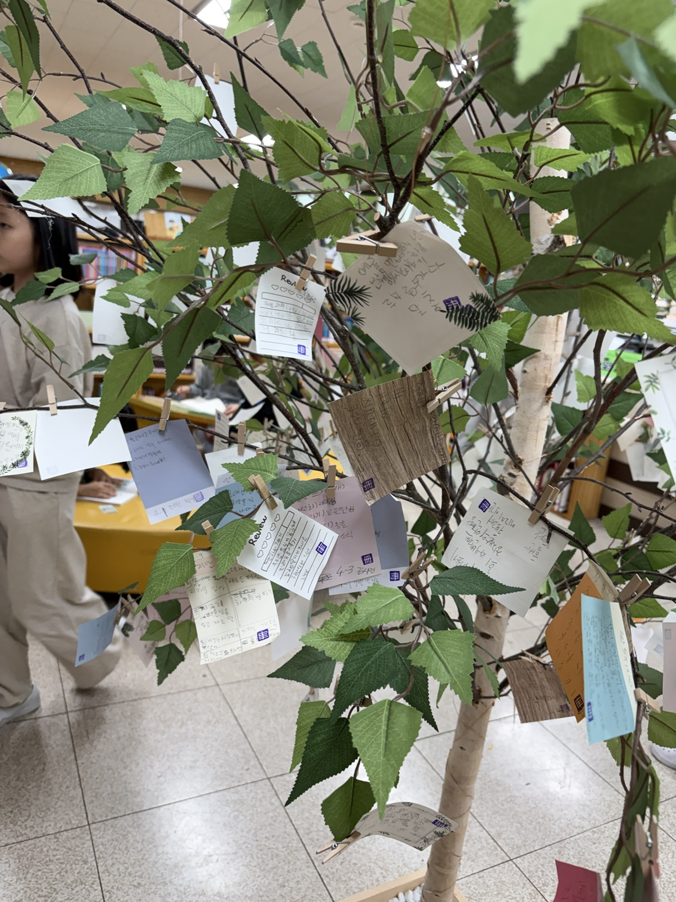

도서관에서 진행한 다문화 지원 활동. 교실 밖 업무도 담임 몫으로 돌아온다.

## 그래서 교사는 어떻게?

2주 정리하면 지금 내가 내린 답은 세 가지다.

- 회사 업무는 노션 MCP로 상당 부분 자동화가 됐다. 학교 업무는 공문이랑 보고서가 전부 한글이라 같은 방식이 안 통했다. 한글 문서를 수정할 수 있는 MCP를 에이전트에 쥐어주는 게 먼저다.
- 발표자료는 HTML 덱이 답이었다. 계획안이랑 템플릿(예를 들어 당근의 Seed Design System 같은 레퍼런스)을 같이 주면 발표자료를 AI Native하게 만들 수 있다.
- 회사에 있을 때는 발표자료 만들 일이 거의 없었다. 노션에 업무 내역 정리해두고 그 페이지 띄워서 약식으로 발표했다. 학교에서는 교사협의회나 수업에서 발표자료를 실제로 쓸 일이 많았다. 같은 도구라도 쓰이는 자리가 다르면 요구가 달라진다.

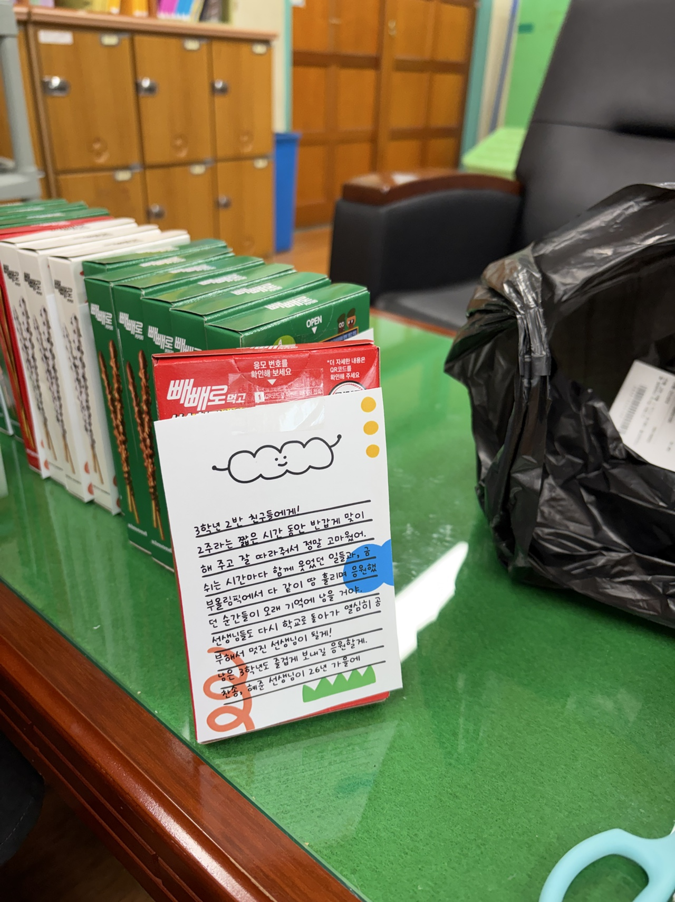

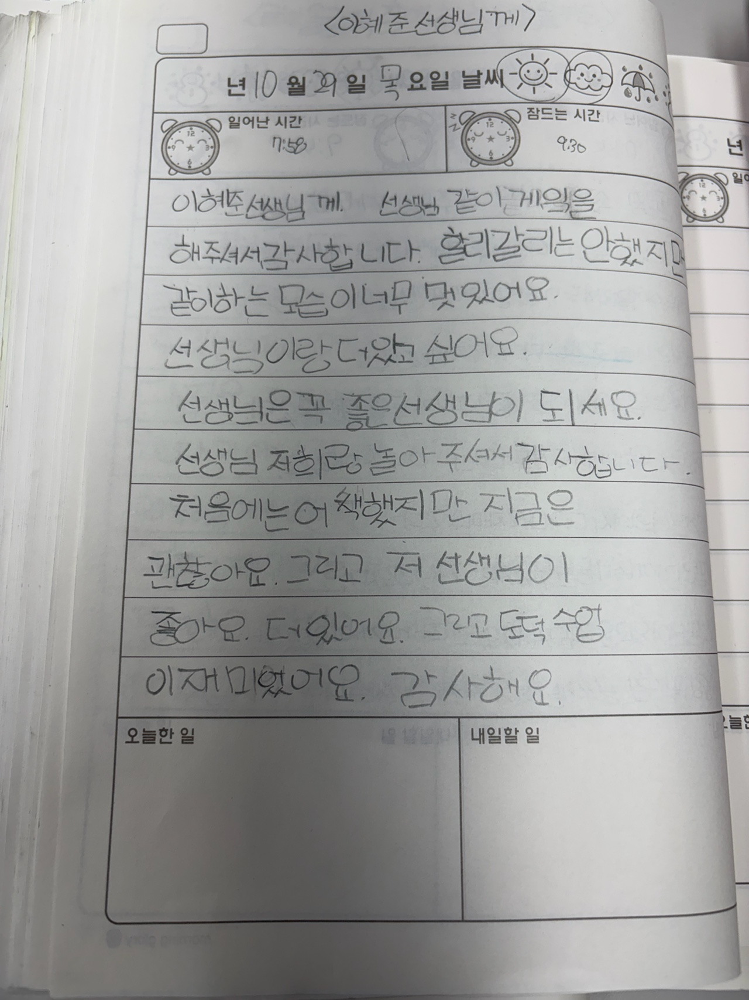

학생이 남긴 편지. "선생님은 꼭 좋은 선생님이 되세요."

